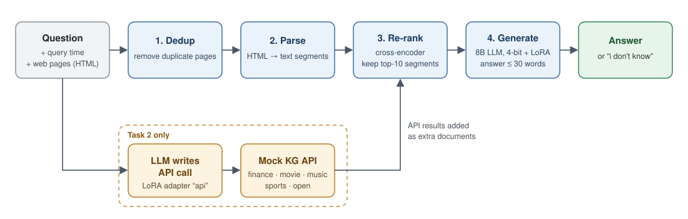
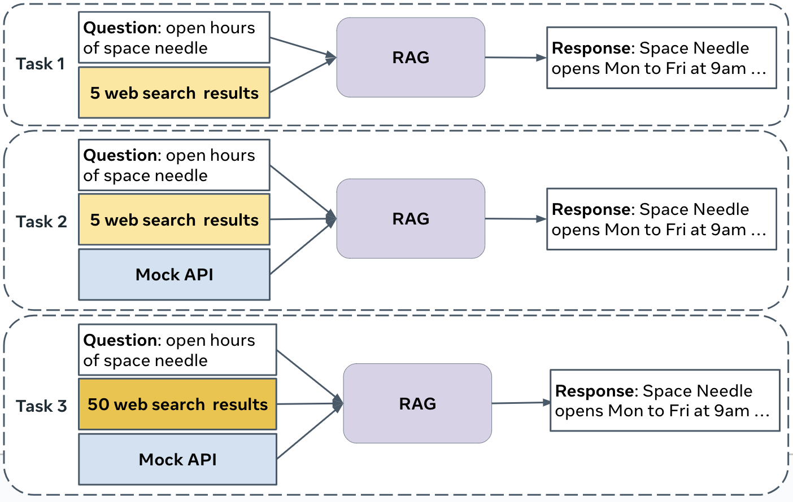

# CRAG: Comprehensive RAG Challenge — Team Solution

Our team's solution for the **Meta CRAG: Comprehensive RAG Benchmark** challenge (KDD Cup 2024, hosted on AIcrowd).



It is a retrieve-then-read pipeline. Web pages are parsed into text segments, a cross-encoder re-ranks them, and a 4-bit quantised 8B LLM with LoRA adapters writes a short answer. When the model is not sure, it is told to answer `i don't know`. For Task 2, the LLM can also write a call to the CRAG mock knowledge-graph API, and the results are merged with the web evidence.

---

## The challenge in short

Each example gives a question, the time it was asked, and a set of retrieved web pages (raw HTML). The system must return a short answer. Scoring rewards honesty:

| Answer type | Score |
| --- | --- |
| Correct | +1 |
| Missing (`i don't know`) | 0 |
| Incorrect / hallucinated | −1 |

| Task | Input |
| --- | --- |
| **Task 1** — Retrieval Summarization | 5 web pages per question |
| **Task 2** — Knowledge Graph + Web Retrieval | 5 web pages + access to mock KG APIs (finance, movie, music, sports, open domain) |
| **Task 3** — End-to-End RAG | 50 web pages + mock KG APIs |

<p align="center">
  
  <br>
  <sub>The three CRAG tasks. Figure from the <a href="https://arxiv.org/abs/2406.04744">CRAG paper</a> (Yang et al., 2024).</sub>
</p>

---

## Pipeline

```
question + search_results (HTML)
        │
        ▼
1. dedup_results            remove duplicate pages
        │
        ▼
2. html2text_parser_traverse  HTML → text segments (multiprocessing pool for Task 3)
        │
        ▼
3. CrossEncoderIR           ms-marco-MiniLM-L-6-v2, fp16, keep top-10 segments
        │                   (Task 2: + segments from an LLM-generated KG API call)
        ▼
4. LLM (4-bit NF4 + LoRA)   few-shot <DOCS> prompt, answer ≤ 30 words
        │
        ▼
"Insufficient information" → "i don't know"
```

### 1–2. Pre-processing
Duplicate search results are removed, and each page's HTML is turned into text segments. For Task 3 (50 pages per question), parsing runs in a `multiprocessing.Pool` so it stays within the time limit.

### 3. Retrieval / re-ranking — [src/models/ir/](src/models/ir/)
| Model | File | Notes |
| --- | --- | --- |
| **Cross-encoder** (default) | [crossencoder.py](src/models/ir/crossencoder.py) | `ms-marco-MiniLM-L-6-v2`, max length 128, batched, fp16 autocast |
| Bi-encoder | [biencoder.py](src/models/ir/biencoder.py) | `multi-qa-MiniLM-L6-cos-v1`, dot-product scores |
| TF-IDF | [tfidf.py](src/models/ir/tfidf.py) | 1–2-gram TF-IDF fitted on Wikipedia lead paragraphs, saved as `models/tfidf.pkl` |
| Ensemble | [ensemble.py](src/models/ir/ensemble.py) | Ranks candidates by their average rank across several retrievers |

All retrievers share the same interface: `get_top_sentences(query, candidates) -> [(segment, score), ...]`.

### 4. Generation — [src/models/llm/](src/models/llm/)
| Class | Base model | File |
| --- | --- | --- |
| `DeepSeek` (default) | `DeepSeek-R1-Distill-Llama-8B` | [deepseek.py](src/models/llm/deepseek.py) |
| `LlamaLLM` | `Meta-Llama-3-8B-Instruct` | [llama.py](src/models/llm/llama.py) |
| `ApiCall` | `llama3.1:8b-instruct` over an OpenAI-compatible endpoint | [interweb_api.py](src/models/interweb_api.py) |

- Models are loaded in **4-bit NF4** (bitsandbytes) with fp16 compute.
- Two **LoRA adapters** (r = 64, α = 32, on `q_proj`/`v_proj`) are loaded side by side:
  - `models/peft_task3` → adapter `context`, for answering from retrieved documents
  - `models/peft_api` → adapter `api`, for writing KG API calls
- The QA prompt includes few-shot examples. It tells the model to stay under 30 words, to answer `Insufficient information` when the context is not enough (the pipeline maps this to `i don't know`), and to answer `Invalid question` when the question has a false premise.
- Prompt formats: `v0`, `v1` (default), and `no_context`, for answering without retrieval.

### Task 2: knowledge-graph API calls
Given the documentation of the mock API functions (`open_search_entity_by_name`, `movie_get_person_info`, `finance_get_price_history_by_ticker`, `music_get_members`, `sports_nba_get_games_on_date`, …), the LLM writes a Python call, or `None`. The call is `eval`'d against the wrappers in `src/data/api_functions.py`. The responses are split into documents, re-ranked with the cross-encoder, and merged with the web segments by score before the answer is generated.

The routing lives in `BaselinePipeline.generate_answer` ([baseline_pipeline.py](src/models/baseline_pipeline.py)) and is chosen by the `TASK_TYPE` constant (`"TASK1"`, `"TASK2"`, `"TASK3"`). Note that `batch_generate_answer`, the method the AIcrowd evaluator calls, always runs the web-only path (dedup → parse → re-rank → answer).

---

## Repository layout

```
.
├── src/                          # Our pipeline
│   ├── paths.py                  # ROOT_DIR, DATA_DIR, MODELS_DIR
│   ├── models/
│   │   ├── baseline_pipeline.py  # BaselinePipeline — the submitted model
│   │   ├── interweb_api.py       # LLM over an OpenAI-compatible API
│   │   ├── ir/                   # cross-encoder, bi-encoder, TF-IDF, ensemble
│   │   └── llm/                  # DeepSeek / Llama wrappers, prompts, Lightning fine-tuning module
│   └── eval/                     # Offline evaluation scripts for Task 1 / Task 3
├── models/
│   ├── user_config.py            # Selects UserModel (currently BaselinePipeline)
│   ├── peft*/                    # LoRA adapter configs
│   ├── <base model folders>/     # HF configs/tokenizers (weights not included)
│   ├── dummy_model.py, Retriever.py, Parse.py, prompt_api.py, pretrain_models/
│   │                             # Reproduction of the db3 team's solution (reference)
│   ├── training_reproduction/    # db3 LoRA training data + notebooks
│   └── *_baseline.py             # Official starter-kit baselines
├── crag-mock-api/                # Official CRAG mock KG API server (FastAPI)
├── prompts/templates.py          # LLM-judge instructions for local evaluation
├── notebooks/                    # Experiments: HTML parsing, retrieval, NLI labelling, answer evaluation
├── local_evaluation.py           # Starter-kit evaluator (predict + LLM-as-judge)
├── Dockerfile, docker_run.sh, aicrowd.json   # AIcrowd submission setup
├── slurm.sh                      # Cluster job script (2 GPUs)
└── requirements.txt
```

---

## Setup

### 1. Environment
Python 3.10 and a CUDA GPU are expected. The reference setup used 2 GPUs (see [aicrowd.json](aicrowd.json) and [slurm.sh](slurm.sh)).

```bash
pip install -r requirements.txt
```

### 2. Model weights
Only configs and tokenizers are in the repo. Download the weights from Hugging Face into `models/`:

| Folder | Hugging Face model |
| --- | --- |
| `models/DeepSeek-R1-Distill-Llama-8B` | `deepseek-ai/DeepSeek-R1-Distill-Llama-8B` |
| `models/Meta-Llama-3-8B-Instruct` | `meta-llama/Meta-Llama-3-8B-Instruct` |
| `models/ms-marco-MiniLM-L-6-v2` | `cross-encoder/ms-marco-MiniLM-L-6-v2` |
| `models/all-Mini-L6-v2`, `models/bge-reranker-v2-m3` | used by the db3 reference retriever |

The LoRA adapter weights (`adapter_model.safetensors`) for `models/peft_task3` and `models/peft_api` also need to be placed in those folders. Without them, set `use_peft=False`.

### 3. Data
Download the CRAG datasets from the AIcrowd challenge page and place them as the scripts expect:

```
data/raw/task1/crag_task_1_dev_v3_release.jsonl   # used by src/eval/*
data/raw/task3/*.jsonl                             # Task 3 dev data
example_data/dev_data.jsonl.bz2                    # used by local_evaluation.py
```

### 4. Mock KG API (Tasks 2 and 3)
```bash
cd crag-mock-api
pip install -r requirements.txt
uvicorn server:app --port 8000
```
The pipeline reads the API location from `CRAG_MOCK_API_URL` (default `http://localhost:8000`).

### 5. API credentials
The LLM judge in `local_evaluation.py` and the `ApiCall` model use an OpenAI-compatible endpoint configured through environment variables:

```bash
export INTERWEB_HOST=<openai-compatible base url>
export INTERWEB_APIKEY=<your key>
export EVALUATION_MODEL_NAME=gemma2:27b   # or gpt-4-0125-preview, gpt-4o, ...
```

---

## Running

All commands are run from the repository root with `PYTHONPATH=.`.

**Full local evaluation** (generate predictions with `UserModel`, then score them with an LLM judge):
```bash
python local_evaluation.py
```

**Offline experiments**, comparing retrievers and prompts on the dev split:
```bash
python -m src.eval.eval_task1 --ir_model crossencoder --prompt_version v1 --include_examples true --num_top_docs 10
python -m src.eval.eval_task3 --ir_model crossencoder --prompt_version v1 --num_top_docs 20
```
Useful flags: `--ir_model {tfidf,biencoder,crossencoder,ensemble}`, `--prompt_version {v0,v1,no_context}`, `--use_peft`, `--peft_path`, `--split {0,1}`, `--num_samples`. Results are written to `results/`.

**On a Slurm cluster:**
```bash
sbatch slurm.sh
```

**AIcrowd submission:** set `UserModel` in [models/user_config.py](models/user_config.py) and `challenge_id` in [aicrowd.json](aicrowd.json), then test the Docker image locally with `./docker_run.sh`.

To switch the generator, change the default in `BaselinePipeline.__init__` (`DeepSeek()` ↔ `LlamaLLM()`), or pass your own `ir_model` / `llm_model`:
```python
from src.models.baseline_pipeline import BaselinePipeline
from src.models.ir import EnsembleIR, CrossEncoderIR, BiEncoderIR
from src.models.llm.llama import LlamaLLM

pipeline = BaselinePipeline(
    ir_model=EnsembleIR([CrossEncoderIR(), BiEncoderIR()]),
    llm_model=LlamaLLM(prompt_format="v1", include_context_examples=True),
)
```

---

## Acknowledgements

- [CRAG benchmark and starter kit](https://gitlab.aicrowd.com/aicrowd/challenges/meta-comprehensive-rag-benchmark-kdd-cup-2024/meta-comphrehensive-rag-benchmark-starter-kit) by Meta & AIcrowd. The evaluator, Dockerfile, baselines and `crag-mock-api/` come from there.
- The **db3** team's KDD Cup 2024 solution. We reproduced it under `models/` (`dummy_model.py`, `Retriever.py`, `Parse.py`, `prompt_api.py`, `training_reproduction/`) as a reference and for comparison.
